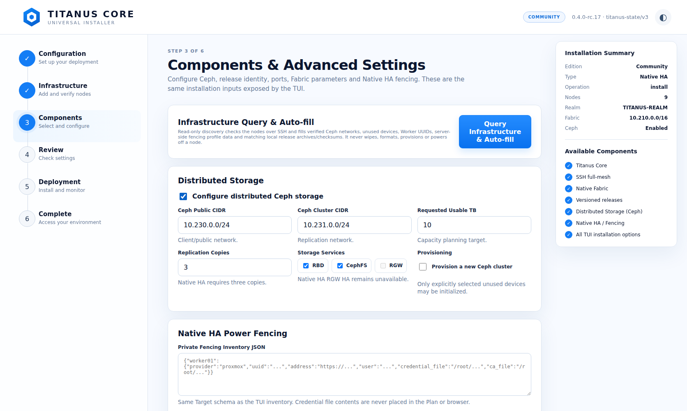
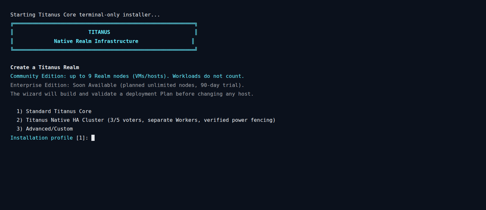
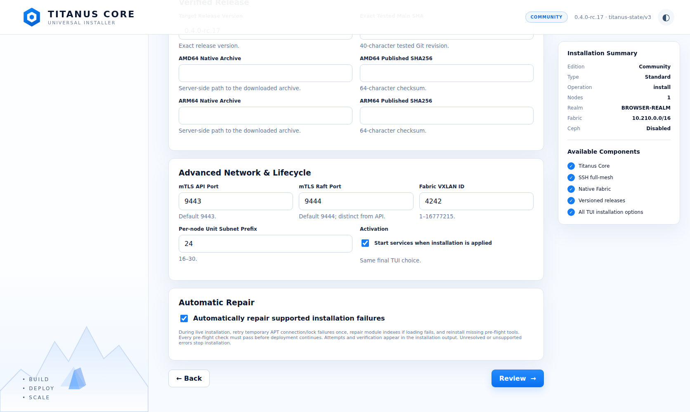

# Titanus Core Web Installer

The Titanus Core Web Installer is an optional browser front-end for the same
validated `titanus-plan/v2` installation model used by the ANSI/TUI installer.
It does not replace or fork the CLI/TUI deployment engine.

## Starting the installer

After installing a release that contains the Web Installer:

```sh
sudo tuigui
```

`tuigui` starts `titanus-installer-web.service`, detects a local
IPv4 address and prints a protected HTTPS URL in English. The URL contains a
protected browser bootstrap fragment. After that first successful sign-in, the
browser keeps an HttpOnly, Secure, SameSite=Strict installer session cookie, so
reopening the same `https://IP:8088/` address in that browser restores the
current status.

The service listens on port `8088` by default. It creates a local self-signed
HTTPS identity under `/var/lib/titanus/installer-web`; therefore a browser may
require explicit certificate confirmation on first use. The root SSH bootstrap
password is never written to the Plan, URL, environment, state file or verbose
log. It is held only in process memory long enough to establish the existing
Realm-scoped SSH trust and is then zeroed.

For the terminal-only setup path:

```sh
sudo tuicli
```

This directly executes the existing `titanus setup` workflow. The Web Installer
service is not required by `tuicli` and the TUI remains independently usable.

## UI and TUI parity

The browser workflow exposes the installation choices from `titanus setup`:

- Community Edition topology (1–9 Realm nodes)
- Standard, Native HA fresh-install and Advanced/Custom profiles
- install, same-profile upgrade and binary rollback where supported
- Realm/Fabric/Service addressing
- node identities, management/Fabric/Ceph addresses and Titanus capabilities
- SSH username/port and the in-memory initial bootstrap password
- full directed SSH trust verification after explicit fingerprint approval
- Ceph provisioning, networks, replication, capacity, RBD/CephFS/RGW policy and
  explicit OSD device selection
- Native HA fencing inventory and the same model validation
- exact release version/revision, AMD64/ARM64 archive paths and pinned SHA-256
- PKI directory, API/Raft ports, per-node subnet prefix, VXLAN ID and service
  activation choice
- offline validate/prepare-only mode or explicitly authorized live apply
- optional automatic repair with bounded attempts and mandatory revalidation
- protected browser download of the validated `titanus-plan/v2` JSON for the same review/export purpose as the TUI Plan output

Enterprise is visible in the common installer shell as **Soon Available**. The
current Community build does not implement Enterprise entitlements or remove the
Community node ceiling.

## Read-only infrastructure query and auto-fill

Step 3 includes **Query Infrastructure & Auto-fill**. It performs a read-only
query before validation and never initializes storage, changes networking,
powers off a node or starts a Titanus deployment. The query uses the node
inventory and the in-memory SSH bootstrap password from Step 2 to:

- detect the common IPv4 network actually used by STORAGE nodes and fill Ceph
  public/cluster CIDRs when they can be proven from the selected interfaces;
- list only whole block devices that are unmounted, have no filesystem/storage
  signatures and have no child mappings, preferring stable `/dev/disk/by-id/`
  paths for Ceph selection;
- refresh DMI UUIDs for Native HA EXECUTION Workers;
- merge those UUIDs into an optional root-owned server-side fencing provider
  profile without returning credential contents to the browser;
- find matching local AMD64/ARM64 release archives for the exact requested
  version/revision, calculate their full-file SHA-256 values, and run the common
  release verifier against the executable inventory and internal checksums;
- warn about existing Titanus/Ceph configuration or active services, changed
  network values, missing networks and conflicts with configured fencing UUIDs.

Existing device selections, fencing identities and archive checksum pins are
preserved for explicit review. A checksum calculated from a newly discovered
local archive establishes integrity against that reviewed local file; it does
not establish the origin of the file. Obtain candidates from trusted release
artifacts. Query results must be reviewed and validated before any deployment.

The optional provider profile is `/etc/titanus/installer-discovery.json`. It must
be a root-owned regular file with mode `0600`. Example (credential contents are
not stored here):

```json
{
  "power_fencing": {
    "worker01": {
      "provider": "proxmox",
      "address": "https://proxmox.example:8006/api2/json/nodes/pve/qemu/2003",
      "user": "titanus-fencer@pve!native-ha",
      "credential_file": "/root/titanus-fencing/proxmox-token",
      "ca_file": "/root/titanus-fencing/proxmox-ca.pem"
    }
  },
  "release_dirs": ["/root/titanus-web-candidate"]
}
```

The Worker UUID is intentionally omitted from the profile: auto-query reads the
current machine identity and fills it. If a provider profile or one of the two
native release archives is unavailable, the installer reports a warning and
leaves that field for explicit operator review rather than inventing a value.
The SSH password is held only for the request and is zeroed after the query.

## Installer screenshots

### `tuigui`



Actual HTTPS Web Installer captured by `scripts/ci-web-installer.cjs`, with a
nine-node documentation-address fixture before running the query. This shows
the Step 3 query control and Native HA settings; it is not live-install evidence.

### `tuicli`



Actual `tuicli` / `titanus setup` startup captured through a pseudo-terminal and
rendered with its ANSI colors. The isolated capture reports systemd inactive and
stops at the first prompt, before any Plan or host changes.

## Optional automatic repair

Both `tuicli` and Step 3 of `tuigui` offer **Automatically repair supported
installation failures**. It defaults to disabled; the choice is stored as
`installation.auto_repair` in the same `titanus-plan/v2` Plan and shown at review.
An omitted field in an older Plan keeps repair disabled. Binary rollback does
not support this option.

With repair enabled, explicit live installation can:

- wait two seconds and retry a failed APT command once when its output identifies
  a temporary DNS/connection or package-lock failure;
- regenerate module indexes with `depmod -a` and retry a failed runtime module
  load once;
- reinstall only the package for a failed `iproute2`, `nftables` or `nsenter`
  pre-flight check, or reload/persist OverlayFS, once per failed check.

After pre-flight repair, every check runs again on **all** selected nodes.
Deployment continues only when the full pre-flight succeeds. Failed repairs,
remaining failures and unsupported checks stop with their node/check identified.
TUI output and the persistent Web Installer verbose log record attempts and
verification. APT success and module loading are also required before continuing.

This option does not bypass SSH identity approval, signature/checksum validation,
disk guards, existing Realm protection or package authentication. It does not
delete package locks, change repositories, run generic package fixes, replay
release activation/Ceph provisioning, or resume an interrupted process. Discovery
and **Validate & Prepare Only** remain free of remote changes even when the option
is selected.



Actual isolated HTTPS browser capture with repair selected, using documentation
addresses; no target installation is performed by this screenshot fixture.

## Progress, verbose output and reconnect behavior

The Deployment screen follows the light Titanus Enterprise Installer reference:
a six-stage navigation rail, installation summary, large progress bar, per-stage
status and a collapsible **Verbose Installation Output** terminal immediately
below the progress bar.

The HTTPD persists non-secret installer state to
`/var/lib/titanus/installer-web/state.json` and verbose events to
`/var/log/titanus/installer-web.log`. Closing, refreshing or temporarily losing
the browser does not stop an in-process deployment; reconnecting shows the
latest persisted percentage, node count, phase and verbose output.

If the installer *service process itself* is restarted during an active apply,
Titanus reports the last durable state as `interrupted`. It deliberately does
not replay a possibly destructive step automatically. The operator must inspect
the verbose output and revalidate before any retry.

## Safety boundaries

The browser calls the existing Titanus model validator, SSH trust implementation,
release verifier, `PrepareRelease` path and `RealmDeployer.ApplyPrepared`. It
never bypasses Community topology limits, Native HA fencing requirements,
checksum verification, preflight, Ceph device guards, schema compatibility or
versioned installation rules.

The web service is not automatically started or enabled by package installation. It is
started only when an administrator runs `tuigui` (or explicitly starts the
systemd unit). `tuicli` stops an idle Web Installer service before entering the
terminal-only setup and refuses to interrupt an active Web Installer deployment. Use it only from a trusted management network and verify the
browser certificate fingerprint out of band when appropriate.


## Live-test candidate from this branch

Starting a live installation automatically installs missing Debian dependencies
on the installer host and selected nodes before pre-flight. This covers
OpenSSH/sshpass on the installer host, and Python, iproute2, nftables, util-linux,
kmod, systemd, archive/checksum tools and CA certificates on the targets.
Ceph clients and, when provisioning is selected, the required storage daemons
are chosen from the Plan; Native HA provider tools are installed on CONTROL
nodes when required. Existing packages are not upgraded. The runtime modules
`overlay`, `bridge`, `veth` and `vxlan` are loaded and persisted in
`/etc/modules-load.d/titanus-runtime.conf`. Package/network failures stop with
the affected node identified unless the optional bounded repair succeeds;
a later explicit attempt installs only what is still missing.

The apply path requires root or passwordless sudo and reachable configured APT
repositories. Existing Realm guards run across all nodes before remote package
changes. A normal pre-flight runs after dependency setup, before payload install.
**Validate & Prepare Only** checks the Plan and local release/configuration
artifacts; it does not contact target hosts or verify these prerequisites.

The selected installer host may already contain the exact matching versioned
Titanus binaries without a Realm. Initial installation permits that binary-only
state, while existing daemon/agent configuration, Realm PKI or Realm data blocks
a fresh installation. A different installed release must first be updated to the
selected candidate. No existing Realm state is adopted or overwritten.

Build and package the exact checked-out commit on Linux AMD64 and Linux ARM64
with `make release`. Both archives and their published `.sha256` files must
refer to that same commit; do not mix the branch Web Installer with rc.17
binaries from another revision. The native CI jobs keep verified release
packages as `release-ubuntu-24.04` and `release-ubuntu-24.04-arm` artifacts.
These branch artifacts are test candidates, not a newly published stable release.

On the selected installer host, install the matching native bundle using the
included `scripts/install-release.sh`. This installs the launch commands and
service unit without starting a deployment. Run `sudo tuigui`, open its printed
protected URL, and confirm the light six-step installer. Start with **Validate
& Prepare Only** and the two verified archive paths/checksums; this mode does
not authenticate to or change the target hosts.

For the later authorized live test, revalidate, approve the independently
verified SSH fingerprints and press **Start Installation**. Refresh the page,
close/reopen it at the same IP, and temporarily disconnect the browser while
monitoring: the backend deployment must continue and the displayed progress
must recover. Collapsing verbose output or scrolling back in it must survive
status updates. A restart of the service itself preserves the checkpoint as
`interrupted`; another start requires explicit revalidation.

`tuicli` requests an authenticated, atomic idle confirmation from the loopback
Web API before stopping the Web service. Once accepted, the API refuses new
installation requests. If the service is busy or cannot confirm its state,
`tuicli` fails without stopping it. This prevents a new Web installation from
racing with a terminal-mode switch.

## Automated verification

The standard five-job CI includes Web Installer race tests, isolated launch
command checks and `scripts/ci-web-installer.cjs`. The browser smoke uses the
real HTTPS service and session cookie to verify access, Plan validation/export,
missing-archive failure reporting, saved progress recovery after service
restart, collapsible output and recovery after a failed status request. Its
checkpoint is a fixture; it does not perform a live installation or contact
the documentation-only node addresses. Browser evidence is kept in the
`web-installer-browser` workflow artifact. Full live deployment and HA
acceptance remain a separate step on explicitly selected hosts.
